# 🚀 Awesome RESTful Automation API

  

  
  
  
  
  
  

---

> 🌟 **Awesome RESTful Automation API** is an extensively curated directory of top-tier RESTful automation platforms, enterprise API management solutions, and open-source developer tooling. Whether you are automating REST API test suites in CI/CD pipelines, orchestrating API gateways, designing OpenAPI schemas, or enforcing enterprise runtime security, this guide covers production-ready tools for every engineering stack.

---

## 📑 Table of Contents

- [🌐 Sector Overview & Market Dynamics](#-sector-overview--market-dynamics)
- [🟦 Enterprise SaaS & Hosted Platforms](#-enterprise-saas--hosted-platforms)
  - [SaaS Solutions Comparison](#saas-solutions-comparison)
  - [Platform Deep Dives](#platform-deep-dives)
- [🟩 Open-Source Software](#-open-source-software)
  - [Open-Source Solutions Comparison](#open-source-solutions-comparison)
  - [OSS Tool Profiles](#oss-tool-profiles)
- [📊 Comparison Matrix at a Glance](#-comparison-matrix-at-a-glance)
- [📈 Star History](#-star-history)
- [🤝 Contributing](#-contributing)
- [📄 License](#-license)

---

## 🌐 Sector Overview & Market Dynamics

The global API management and automation testing market is estimated at **$6.2 billion in 2025 and projected to surpass $18.4 billion by 2032**, demonstrating an explosive ~16.8% CAGR driven by microservices sprawl, cloud-native architectures, and autonomous AI-agent workflows. 

The sector is **moderately fragmented**: hyper-scale cloud providers and enterprise giants (AWS, Microsoft Azure, Salesforce MuleSoft) dominate foundational enterprise gateway infrastructure, while a dynamic, fast-evolving specialist ecosystem (Kong, Postman, SmartBear, and agile open-source disruptors like Hoppscotch and Bruno) captures specialized niches across developer testing, spec-driven edge case fuzzing, and GitOps-native API design.

---

## 🟦 Enterprise SaaS & Hosted Platforms

Commercial, cloud-hosted RESTful automation and API management platforms engineered for high reliability, cross-team collaboration, enterprise compliance, and automated orchestration.

### SaaS Solutions Comparison

| Platform / Vendor | Primary Focus | Company Size (Revenue / Valuation) | Starting Tier Pricing | Free Tier / Trial Limit | Key Highlights |
| :--- | :--- | :--- | :--- | :--- | :--- |
| **[Microsoft Azure API Management](https://azure.microsoft.com/en-us/products/api-management/)** ☁️ | Cloud-native API Gateway & Governance | **$245B+ Annual Revenue** (Valuation: ~$3.1T) | **$0.07 per hour** (~$51.10/mo) for Developer Tier; Consumption tier at $3.50/million calls | Free tier includes **1 million free API calls/month** (Consumption Tier) | Deep Entra ID (Azure AD) identity integration, serverless bindings, and unified telemetry via Azure Monitor. |
| **[AWS API Gateway](https://aws.amazon.com/api-gateway/)** ☁️ | Managed REST, HTTP & WebSocket Gateway | **$107B+ AWS Annual Run-Rate** (Amazon Valuation: ~$2.2T) | **$1.00 per million calls** (HTTP APIs) / **$3.50 per million calls** (REST APIs) | AWS Free Tier: **1 million REST/HTTP API calls per month** for the first 12 months | Direct AWS IAM policies, Lambda proxy integration, automated throttling, and AWS CloudWatch logging. |
| **[MuleSoft Anypoint Platform](https://www.mulesoft.com/)** 🔗 | Enterprise Integration, ESB & API Lifecycle | **$38B+ Salesforce Revenue** (Salesforce Valuation: ~$280B) | Starting at **~$3,000/month** ($36,000/year billed annually) for Starter Package | **30-day full-access free trial** with access to Anypoint Studio and CloudHub (no perpetual free tier) | API-led connectivity, 300+ enterprise connectors, graphical DataWeave transformations, and Anypoint Exchange. |
| **[SwaggerHub](https://swagger.io/tools/swaggerhub/)** 📐 | OpenAPI Design, Governance & Documentation | **~$250M+ ARR** (SmartBear parent; Private Equity backed) | **$90 per month** ($1,080/year) for Team Plan (includes 3 designers) | **14-day free trial** of Team features; perpetual Free plan limited to **3 APIs and 1 user seat** | Centralized OpenAPI (OAS 3.0/3.1) design standardization, mock integrations, and style-guide enforcement. |
| **[Postman](https://www.postman.com/)** 🧪 | API Development, Testing Automation & CLI Workflows | **~$200M+ ARR** (Valued at **$5.6B**) | **$14 per user/month** (billed annually) for Basic Plan | Free plan forever for up to **3 team members**, with **1,000 collection runs/month** and 25 mock calls | Industry-standard API client, Newman/Postman CLI integration for CI/CD, mock servers, and automated script assertions. |
| **[Kong Konnect](https://konghq.com/products/kong-konnect)** 🛡️ | Cloud Control Plane & Managed API Gateway | **~$150M+ ARR** (Valued at **$2.0B**) | **$250 per month** for Plus Plan (covers 3 data plane nodes and basic RBAC) | Free forever plan with **up to 3 data plane nodes**, 1 runtime group, and basic control plane monitoring | High-throughput OpenResty core, AI Gateway capabilities (LLM proxy, prompt formatting), and global edge sync. |
| **[Druva REST API](https://www.druva.com/)** 💾 | Data Protection & Enterprise Backup Automation | **~$250M+ ARR** (Valued at **$2.0B**) | Included with Enterprise Backup subscriptions starting at **~$2.50 per user/month** | **30-day fully functional free trial** supporting live endpoint and M365 workload protection | Programmatic REST endpoints for backup trigger automations, legal hold workflows, and SIEM pipeline telemetry. |

---

### Platform Deep Dives

#### ☁️ Microsoft Azure API Management
* **Overview:** Azure API Management provides turnkey API gateway proxies, self-service developer portals, and centralized policy enforcement within the Microsoft cloud ecosystem.
* **Automation Strengths:** Integrates seamlessly with Azure DevOps pipelines, GitHub Actions, Entra ID authentication, and Azure Monitor metrics.
* **Best Suited For:** Organizations standardized on Azure services and multi-region microservices requiring fine-grained token validation.

#### ☁️ AWS API Gateway
* **Overview:** A fully managed service making it straightforward for developers to create, publish, maintain, monitor, and secure RESTful, HTTP, and WebSocket APIs at scale.
* **Automation Strengths:** Native AWS CloudFormation and Terraform CDK support; direct triggers into AWS Lambda and step functions.
* **Best Suited For:** Serverless microservice architectures executing high-throughput REST workloads.

#### 🔗 MuleSoft Anypoint Platform
* **Overview:** The industry standard for enterprise integration and ESB orchestration, combining API management with DataWeave transformation engines.
* **Automation Strengths:** Comprehensive automated test suites via MUnit, Maven CLI plugins, and automated connector generation.
* **Best Suited For:** Fortune 500 enterprises modernizing legacy mainframes and connecting ERPs, CRMs, and custom endpoints.

#### 📐 SwaggerHub (SmartBear)
* **Overview:** Hosted collaborative OpenAPI design and governance environment built on Swagger Editor and Swagger UI.
* **Automation Strengths:** Automated Git synchronization, schema linting via Spectral, and automated client SDK code generation.
* **Best Suited For:** Engineering organizations practicing strict "API-First" schema design and collaborative contract review.

#### 🧪 Postman
* **Overview:** The ubiquitously adopted API client supporting JavaScript testing assertions, dynamic environment variables, and automated collection runs.
* **Automation Strengths:** Command-line continuous testing through Newman and Postman CLI; automated webhooks and monitor executions.
* **Best Suited For:** Developers, QA engineers, and cross-functional product teams needing collaborative API mocking and CI test suites.

#### 🛡️ Kong Konnect
* **Overview:** Enterprise SaaS management plane for Kong Gateway, orchestrating API traffic, service meshes, and AI LLM gateways.
* **Automation Strengths:** Declarative `decK` CLI configuration management, automated RBAC synchronization, and GitOps-driven gateway routing.
* **Best Suited For:** High-volume low-latency infrastructure teams modernizing hybrid-cloud gateway deployments.

#### 💾 Druva REST API
* **Overview:** Specialized RESTful platform enabling complete programmatic automation over cloud backup, disaster recovery, and data compliance.
* **Automation Strengths:** JSON-formatted request handling with token-based authentication for CI/CD restore verification and SIEM log streaming.
* **Best Suited For:** Cloud security and SecOps teams orchestrating autonomous disaster recovery testing and audit logging.

---

## 🟩 Open-Source Software

Curated, high-impact open-source solutions for RESTful automation, testing, traffic routing, and schema validation. Ranked strictly by GitHub community stars.

### Open-Source Solutions Comparison

| Repository | GitHub Stars Badge | Tech Stack | License | Category | Best For |
| :--- | :---: | :--- | :--- | :--- | :--- |
| **[Hoppscotch](https://github.com/hoppscotch/hoppscotch)** ⚡ |  | TypeScript / Vue | MIT | API Development & Testing Client | Lightweight, ultra-fast web and desktop Postman alternative. |
| **[Traefik](https://github.com/traefik/traefik)** 🚦 |  | Go | MIT | Cloud-Native Reverse Proxy & Gateway | Automatic microservice route discovery with dynamic TLS termination. |
| **[Bruno](https://github.com/usebruno/bruno)** 🐶 |  | JavaScript / Electron | MIT | Git-Native Offline API Client | Storing collections directly in Git repositories as plain-text `.bru` files. |
| **[Kong Gateway](https://github.com/Kong/kong)** 🦍 |  | Lua / OpenResty | Apache 2.0 | High-Performance Cloud API Gateway | Battle-tested edge routing, plugin extensibility, and hybrid deployments. |
| **[k6](https://github.com/grafana/k6)** 📊 |  | Go / JavaScript | AGPL 3.0 | API Load Testing & Performance Automation | Developer-centric, scriptable API load, stress, and spike test automation. |
| **[Envoy Proxy](https://github.com/envoyproxy/envoy)** 🛡️ |  | C++ | Apache 2.0 | L7 Edge & Service Mesh Proxy | Cloud-native resilient service-to-service communication and observability. |
| **[Dapr](https://github.com/dapr/dapr)** 🧩 |  | Go | Apache 2.0 | Distributed Application Runtime | Portable, event-driven REST and gRPC building blocks for microservices. |
| **[Keploy](https://github.com/keploy/keploy)** 🤖 |  | Go / eBPF | Apache 2.0 | Zero-Code API Test & Mock Generation | Recording real network API traffic and converting it into automated regression suites. |
| **[Apache APISIX](https://github.com/apache/apisix)** 🚀 |  | Lua / NGINX / etcd | Apache 2.0 | Dynamic Cloud-Native API Gateway | High-throughput routing with dynamic configuration updates via etcd. |
| **[Tyk Gateway](https://github.com/TykTechnologies/tyk)** 💡 |  | Go | MPL 2.0 | Full-Lifecycle Open Source API Gateway | Multi-tenant deployments, developer portal, and native Go plugin ecosystem. |
| **[Karate](https://github.com/karatelabs/karate)** 🥋 |  | Java | MIT | BDD API Test Automation Framework | Single DSL unifying API test automation, mocks, UI, and Gatling performance. |
| **[REST Assured](https://github.com/rest-assured/rest-assured)** ☕ |  | Java | Apache 2.0 | Java REST Testing DSL | Fluent `given().when().then()` syntax for validating complex JSON/XML responses. |
| **[Schemathesis](https://github.com/schemathesis/schemathesis)** 🔬 |  | Python | MIT | Property-Based OpenAPI Testing | Autonomous contract fuzzing that discovers crashes and schema non-compliance. |
| **[Gravitee API Management](https://github.com/gravitee-io/gravitee-api-management)** 🎛️ |  | Java | Apache 2.0 | Event-Driven & REST API Gateway | Unifying synchronous HTTP REST endpoints with asynchronous Kafka/MQTT event streams. |

---

### OSS Tool Profiles

#### ⚡ [Hoppscotch](https://github.com/hoppscotch/hoppscotch)
* **Stack:** TypeScript, Vue | **License:** MIT
* An open-source, web-first API development ecosystem created as an ultra-fast, privacy-respecting alternative to Postman. Supports REST, GraphQL, WebSocket, Server-Sent Events, and MQTT out of the box with zero telemetry tracking.

#### 🚦 [Traefik](https://github.com/traefik/traefik)
* **Stack:** Go | **License:** MIT
* A modern HTTP reverse proxy and load balancer designed to integrate directly with Docker, Swarm, Kubernetes, and Consul. Automatically discovers new services and configures routing rules and Let's Encrypt SSL certificates dynamically.

#### 🐶 [Bruno](https://github.com/usebruno/bruno)
* **Stack:** JavaScript, Electron | **License:** MIT
* An offline-only, Git-native desktop API client that stores collections directly in your code repository as human-readable `.bru` files. Enables straightforward Git versioning, code reviews, and CLI execution without cloud synchronization dependencies.

#### 🦍 [Kong Gateway](https://github.com/Kong/kong)
* **Stack:** Lua, OpenResty | **License:** Apache 2.0
* The world’s most adopted open-source cloud-native API gateway. Delivers sub-millisecond routing latency, extensive authentication and rate-limiting plugin architectures, and declarative DB-less operational modes.

#### 📊 [k6](https://github.com/grafana/k6)
* **Stack:** Go, JavaScript | **License:** AGPL 3.0
* Built by Grafana Labs, k6 is an open-source load-testing and API performance automation tool designed for engineering teams. Tests are written in ES6 JavaScript with clear thresholds, making it ideal for CI/CD regression pipelines.

#### 🛡️ [Envoy Proxy](https://github.com/envoyproxy/envoy)
* **Stack:** C++ | **License:** Apache 2.0
* A CNCF graduated L7 proxy and communication bus engineered for large-scale modern service-oriented architectures. Provides dynamic service discovery, circuit breaking, health checks, gRPC translation, and rich observability.

#### 🧩 [Dapr](https://github.com/dapr/dapr)
* **Stack:** Go | **License:** Apache 2.0
* The Distributed Application Runtime (Dapr) provides portable, event-driven building blocks via standard HTTP and gRPC APIs. Automates state management, service-to-service invocation with mTLS, pub/sub messaging, and actor patterns.

#### 🤖 [Keploy](https://github.com/keploy/keploy)
* **Stack:** Go, eBPF | **License:** Apache 2.0
* A no-code API testing platform that utilizes Linux eBPF to capture incoming and outgoing network traffic, automatically generating regression test cases and mock data without modifying application source code.

#### 🚀 [Apache APISIX](https://github.com/apache/apisix)
* **Stack:** Lua, NGINX, etcd | **License:** Apache 2.0
* An Apache Software Foundation top-level project delivering a dynamic, real-time, high-performance API gateway. Features dynamic routing, traffic sharding, hot reload of plugins without server restarts, and multi-protocol transcoding.

#### 💡 [Tyk Gateway](https://github.com/TykTechnologies/tyk)
* **Stack:** Go | **License:** MPL 2.0
* An enterprise-grade, open-source API gateway written entirely in Go. Uniquely provides developer portal capabilities, key management, quota tracking, and multi-tenancy in its self-hosted open-source distribution.

#### 🥋 [Karate](https://github.com/karatelabs/karate)
* **Stack:** Java | **License:** MIT
* An all-in-one test automation framework that combines API test-automation, mocks, end-to-end UI testing, and Gatling-based performance testing into a single unified Gherkin DSL without requiring boilerplate glue code.

#### ☕ [REST Assured](https://github.com/rest-assured/rest-assured)
* **Stack:** Java | **License:** Apache 2.0
* The premier Java library for simplifying testing of RESTful APIs. Provides a domain-specific language (DSL) inspired by dynamic languages (Ruby/Groovy), bringing expressive Given-When-Then BDD testing to Java backends.

#### 🔬 [Schemathesis](https://github.com/schemathesis/schemathesis)
* **Stack:** Python | **License:** MIT
* A modern, specification-based testing tool that automatically generates thousands of test scenarios from OpenAPI and GraphQL schemas to pinpoint unhandled edge cases, 500 server crashes, and spec violations before release.

#### 🎛️ [Gravitee API Management](https://github.com/gravitee-io/gravitee-api-management)
* **Stack:** Java | **License:** Apache 2.0
* A flexible, open-core API management platform bridging traditional synchronous RESTful web services with event-driven architectures (Kafka, RabbitMQ, WebSockets), accompanied by a self-service developer portal.

---

## 📊 Comparison Matrix at a Glance

| Solution | Deployment Model | Open Source? | Primary Focus | Best Use Case |
| :--- | :---: | :---: | :--- | :--- |
| **Azure API Management** | Cloud SaaS | ❌ | Gateway & Enterprise Governance | Azure-native microservices & enterprise security |
| **AWS API Gateway** | Cloud SaaS | ❌ | Serverless & REST Gateway | Scalable AWS Lambda & HTTP API fronting |
| **MuleSoft Anypoint** | Cloud / Hybrid | ❌ | Enterprise Integration & ESB | Legacy systems transformation & multi-cloud data sync |
| **SwaggerHub** | Cloud SaaS | ❌ | OpenAPI Design & Governance | Centralized OAS spec design & contract enforcement |
| **Postman** | Cloud / Desktop | ❌ | API Client & CI Testing Automation | QA exploratory testing & Newman automated pipelines |
| **Kong Konnect** | Cloud SaaS | ❌ | Managed Gateway & AI Mesh | Multi-cloud control plane for Kong data planes |
| **Druva REST API** | Cloud SaaS | ❌ | Backup & Disaster Recovery Automation | Autonomous backup telemetry & recovery validation |
| **Hoppscotch** | Self-Hosted / Web | ✅ (MIT) | API Development Client | Fast, self-hosted web-based Postman alternative |
| **Traefik** | Self-Hosted | ✅ (MIT) | Cloud-Native Reverse Proxy | Dynamic container routing with automatic SSL |
| **Bruno** | Self-Hosted / Desktop | ✅ (MIT) | Git-Native API Client | Versioning API requests directly in Git repositories |
| **Kong Gateway** | Self-Hosted | ✅ (Apache 2.0) | High-Performance Gateway | Extreme low-latency API proxying & plugin ecosystem |
| **k6** | Self-Hosted / CLI | ✅ (AGPL 3.0) | Performance & Load Testing | Developer-centric JavaScript-driven load test automation |
| **Envoy Proxy** | Self-Hosted | ✅ (Apache 2.0) | L7 Edge & Mesh Proxy | Distributed service-to-service communication |
| **Dapr** | Self-Hosted | ✅ (Apache 2.0) | Distributed App Runtime | Standardized REST/gRPC microservice building blocks |
| **Keploy** | Self-Hosted | ✅ (Apache 2.0) | Zero-Code Test & Mock Gen | Generating regression tests directly from live traffic |
| **Apache APISIX** | Self-Hosted | ✅ (Apache 2.0) | Dynamic Cloud-Native Gateway | Dynamic configuration reload via etcd & rich plugins |
| **Tyk Gateway** | Self-Hosted | ✅ (MPL 2.0) | Full Lifecycle API Gateway | Multi-tenant deployments with developer portal |
| **Karate** | Self-Hosted / Java | ✅ (MIT) | BDD API & Performance Testing | Single DSL for API testing, mocks, and load testing |
| **REST Assured** | Self-Hosted / Java | ✅ (Apache 2.0) | Java BDD REST Testing DSL | Native Java microservices automated integration testing |
| **Schemathesis** | Self-Hosted / Python | ✅ (MIT) | Property-Based Contract Fuzzing | Autonomous OpenAPI schema validation & crash hunting |
| **Gravitee** | Self-Hosted | ✅ (Apache 2.0) | Synchronous & Event API Gateway | Unified management of REST APIs and Kafka streams |

---

## 📈 Star History

---

## 🤝 Contributing

Contributions are welcome! If you know of an outstanding RESTful automation API tool, gateway, or testing framework that belongs here, please feel free to open a pull request:

1. 🍴 Fork the repository.
2. 🌿 Create your feature branch (`git checkout -b feature/new-rest-tool`).
3. ✍️ Add the tool in alphabetical or categorized order with clear license, stack, and pricing details.
4. 🚀 Commit your changes (`git commit -m 'Add awesome tool'`).
5. 📤 Push to the branch (`git push origin feature/new-rest-tool`).
6. 🎯 Open a Pull Request.

Please ensure all submitted projects are actively maintained (releases or commits within the past 12 months) and clearly distinguish between open-source and commercial offerings.

---

## 📄 License

This compilation is licensed under the [Creative Commons Zero v1.0 Universal](LICENSE) (CC0 1.0) Public Domain Dedication. Individual software products, tools, and logos mentioned are trademarks and copyrights of their respective owners.

---

  ⭐ <b>Found this resource useful? Please star the repository to support continuous updates!</b> ⭐

